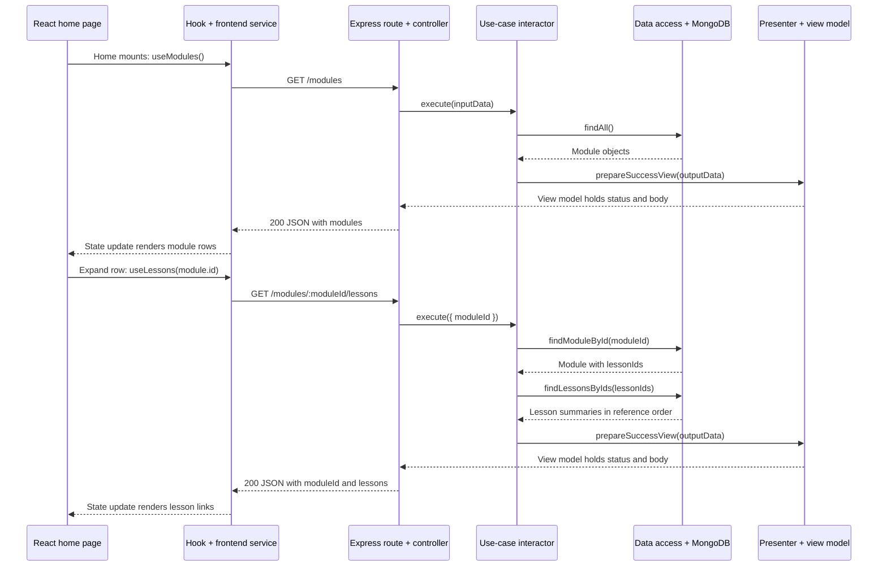

Here we will take the example of our home page List module to illustrate who our backend wiring logic works based on MERN Stack. 

## 1. The big picture 

Mongo DB: database we used to store data (module and lessons info)
Express.js: application framework works for Node.js; Handle HTTP methods like GET. 
React: display our frontend and respond to click 
Node.js: runs our backend server 

The project  divides code into responsibilities. React components handle display, hooks handle loading state, frontend services choose API operations, and the HTTP client sends requests. On the backend, routes connect HTTP to controllers, interactors perform use cases, data access queries MongoDB, and presenters prepare response data.

**Sequence diagram:** 




How does a use case work: 
```text
User opens a page or clicks something

→ React component / hook

→ Frontend service

→ apiClient sends an HTTP request

→ Express matches a route

→ Controller creates input data

→ Interactor performs the use case

→ Data-access adapter queries MongoDB

→ Interactor passes output data to presenter

→ Presenter fills a view model

→ Express route sends the JSON response

→ Frontend service unwraps the response

→ Hook updates state

→ React renders the result

```

## 2. How to build a use case (List module) from scrach?

1. Create application/usecase: create use case interactor, input boundary, input data, output boundary, output data and data access interface 
2. In list module data access interface, we should define the method needed in data access object for list module 
```text
export class ListModulesDataAccess {
  async findAll() {
    throw new Error("findAll not implemented");
  }
}
```
Here we established that data access object need to supply findAll() method 
3. Implement interactor: 
	1. Interactor received moduleData (moduleData is a MongoListModuleDataAccess object created in server, the route receies it and passes it into interactor) and outputBoundary
	2. Implement execute that looks like - here we 1. request the module data from the data access object through the method contracted in data access interface. 2. builds the output in the format we need. 3. pass the output data to the presenter through outputboundary. 
```text
async execute() {
  const modules = await this.moduleData.findAll();

  const outputData = new ListModulesOutputData({
    modules: modules.map((module) => ({
      id: module.id,
      title: module.title,
      description: module.description,
      lessonIds: module.lessonIds,
    })),
  });

  return this.outputBoundary.prepareSuccessView(outputData);
}
```

4. Implement data access adapter that gives the findall() method:
	1. In MongoListModuleDataAccess.js, we have the method that queries our Mongo db database:
```text
async findAll() {
  const modules = await db.collection("modules")
    .find({})
    .toArray();

  return modules.map((module) => ({
    id: module.module_id,
    title: module.title,
    description: module.description,
    lessonIds: module.lessons ?? [],
  }));
}
```
5. Implement controller:
	1. Controller should pass interactor as the input boundary contract into its constructor
	2. Call execute on the input boundary (which is calling execute on the interactor)
6. Implement the presenter and view model:
	1. The presenter receives the output data and updates the viewmodel with either the success or fail view and the http status (success 200 or fail 500). 
	2. The viewmodel holds the status and the response body 
7. Wire the backend in the route:
	1. In ListModuleRoute.js, each request creates a fresh view model, presenter, interactor, and controller.
	2. `await controller.execute()` waits for the database work and presentation to finish 
```text
export function createListModulesRoute({ moduleData }) {
  const router = express.Router();

  router.get("/", async (req, res, next) => {
    try {
      const viewModel = new ListModulesViewModel();

      const presenter = new ListModulesPresenter(viewModel);

      const interactor = new ListModulesInteractor({
        moduleData,
        outputBoundary: presenter,
      });

      const controller = new ListModulesController(interactor);

      await controller.execute();

      return res.status(viewModel.httpStatus).json(viewModel.body);
    } catch (error) {
      next(error);
    }
  });

  return router;
}
```
8. Registor the route in server.js
	1. In the route file, `createListModulesRoute()` creates an Express router and registers a GET handler using `router.get("/", handler)`. The function then returns the router.
	2. After we have got GET router, `server.js` attaches the router at `/modules`: `app.use("/modules", createListModulesRoute({ moduleData }));` This line tells Express to pass requests under `/modules` to this router. 
	3. The mount path `/modules` combines with the router’s local path `/`. Because the handler uses `.get()`, it handles `GET /modules`
	4.  When the frontend sends that request, Express runs the handler. The handler calls the controller, waits for the use case to finish, and sends the prepared JSON response back to the frontend.
9. Add the frontend client service
	1. In `moduleservice.js`, `moduleService.list()` returns the response in array 
10. give the hood access to moduleService 
	1. make `moduleService` available to the React component and hooks inside `ServicesProvider`.
	2. The provider holds the service objects and shares them through React Context, so a hook can access `moduleService` by calling `useServices()`
	3. **This step can actually be simplified:** 
		1. import each service directly into its hook 
		2. remove the hook's `useService()` call
		3. Remove `serviceProvider`
11. ==Create hook that loads and remember the data== 
	1. after the hood has access to the service, in `useModules.js`
		1. It imports the service
		2. creates state to remember the modules 
		3. calls the service inside `useEffect` and save the result